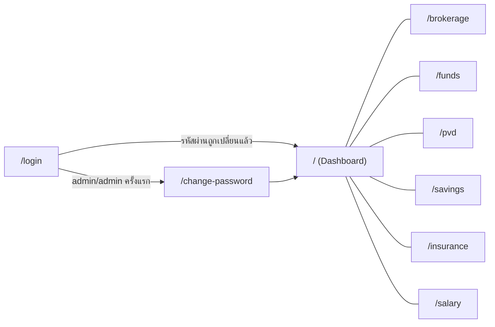

# 01 · Design Pages (Review)

เอกสารนี้ใช้ review หน้าจอทั้งหมด แต่ละหน้า map มาจากชีตใน `Portfolio-Tracker.xlsx` 1:1
เพื่อให้ย้ายจาก Excel มาใช้ได้ทันที แล้วค่อยปรับ UX ทีหลัง

## Sitemap



| Route | หน้า | ชีตต้นทาง | API |
|---|---|---|---|
| `/login` | Login | – | `POST /api/auth/login` |
| `/change-password` | ตั้งรหัสผ่านใหม่ (บังคับครั้งแรก) | – | `POST /api/auth/password` |
| `/` | Dashboard | Dashboard | `GET /api/dashboard` |
| `/brokerage` | Brokers + Deposit/Withdraw log | Brokerage | `/api/brokers`, `/api/broker-transactions` |
| `/funds` | Mutual Funds | Funds | `/api/funds` |
| `/pvd` | Provident Fund รายปี | PVD | `/api/pvd-years` |
| `/savings` | Savings Accounts | Savings | `/api/savings-accounts` |
| `/insurance` | Companies + Premium log | Insurance | `/api/insurers`, `/api/insurance-payments` |
| `/salary` | Salary & Tax (เลือกปี) | Salary & Tax 2026 | `/api/salary-months`, `/api/tax-deductions` |

## App shell

```
┌──────────────────────────────────────────────────────────────────────────┐
│ Portfolio สมุดพอร์ต  Overview  Brokerage  Funds  Provident fund  …   e2e  Log out │
├──────────────────────────────────────────────────────────────────────────┤
│  <Page title>                                                            │
│  ┌ Card ─────────────────────────────────────────────────── [+ Add] ┐    │
│  │ table …                                                          │    │
│  └──────────────────────────────────────────────────────────────────┘    │
└──────────────────────────────────────────────────────────────────────────┘
```

- เมนูอยู่ด้านบน (`Layout.tsx`) หน้าที่เปิดอยู่มี `aria-current="page"`
- Light/Dark ตาม OS (`prefers-color-scheme`) และ override ได้ด้วย `<html data-theme="dark|light">`
- ตัวเลขชิดขวา และใช้ `tabular-nums` ทุกตาราง

## 1. Login


- ฟอร์มมีแค่ Username/Password ไม่มี "remember me" เพราะ session อยู่ได้ 7 วันอยู่แล้ว
- ถ้าผิด แสดงข้อความกลาง ๆ ว่า `invalid username or password` (ไม่บอกว่าผิดที่ user หรือ password)
- จำกัด 10 ครั้ง/นาที/IP (Fiber limiter)

## 2. Change password (บังคับครั้งแรก)

```
┌──────── ตั้งรหัสผ่านใหม่ ────────┐
│ ⚠ บัญชีนี้ยังใช้รหัสผ่านเริ่มต้น   │
│ Current password  [........]   │
│ New password      [........]   │
│ Confirm           [........]   │
│ [ Save password ]   Log out    │
└────────────────────────────────┘
```

- ถ้ายังไม่ได้เปลี่ยน backend ตอบ `403 PASSWORD_CHANGE_REQUIRED` ทุก endpoint ยกเว้น `/auth/me`, `/auth/logout`, `/auth/password`
- รหัสผ่านใหม่ต้องยาวอย่างน้อย 8 ตัวอักษรและห้ามเป็น `admin` เปลี่ยนแล้ว session อื่นทั้งหมดจะถูก revoke

## 3. Dashboard


| ส่วน | ที่มา |
|---|---|
| ประโยคบนสุด: มูลค่ารวม, มากกว่า/น้อยกว่าเงินที่ใส่ไปเท่าไร (%), ต้นทุนรวม | `total` จาก `GET /api/dashboard` |
| ดอกเบี้ยเงินฝากโดยประมาณต่อปี | `estSavingsInterestPerYear` = Σ balance × rate |
| Donut + ตาราง Allocation | `classes` (มูลค่า, ต้นทุน, P/L, P/L %, สัดส่วน) หมวดที่มูลค่าเป็น 0 ไม่แสดงใน donut แต่ยังอยู่ในตาราง hover แถวแล้ว donut เน้นหมวดนั้น |
| พอร์ตว่าง | แสดงข้อความแนะนำให้เริ่มจาก Brokerage หรือ Savings |

ภาพทั้งหมดในหน้านี้สร้างจากข้อมูลสมมติ (`make docs-screenshots`)

แต่ละ asset class มีสีประจำตัวคงที่ (Stocks=น้ำเงิน, Funds=ส้ม, PVD=เขียวน้ำทะเล, Savings=เหลือง, Insurance=ชมพู)
สีไม่เปลี่ยนตามลำดับหรือการกรอง ข้อมูลเดียวกันมีในตารางด้วย จึงไม่ต้องดูจากสีอย่างเดียว

## 4. Brokerage


- Card บน = **Brokers** แก้ได้เฉพาะ Name / Current Value / Note ส่วน Deposits, Withdrawals, Net Capital, P/L และ P/L % คำนวณจากรายการด้านล่าง
- Card ล่าง = **Deposit / Withdraw log** เลือก Broker จาก dropdown และ Type ได้แค่ deposit/withdraw (เท่ากับ data validation ใน Excel)
- เพิ่มหรือลบ log แล้ว card บนจะ refresh เอง

## 5. Mutual Funds / 6. PVD / 7. Savings

ใช้ component `ResourceTable` ตัวเดียวกันทั้งหมด

```
┌ Funds ───────────────────────────────────────────────── [+ Add] ┐
│ Fund │ Category ▾ │ Cost │ Market Value │ P/L (auto) │ P/L % │ Note │ Edit Delete │
│ ...                                                            │
│ Total│            │ Σ    │ Σ            │ Σ          │       │      │             │
└────────────────────────────────────────────────────────────────┘
```

- คอลัมน์ `auto` = ค่าที่ API คำนวณให้ แก้ไม่ได้
- Savings: กรอก Interest Rate เป็น % (2.5) แต่เก็บใน DB เป็น basis points (250)

## 8. Insurance


- Companies: Payments (นับงวด) และ Total Paid คำนวณให้อัตโนมัติ
- Premium log: `Payment #` ได้จาก `ROW_NUMBER() OVER (PARTITION BY insurer)` เหมือน `COUNTIF($F$6:$F6,$F6)` ใน Excel

## 9. Salary & Tax

```
Salary & Tax                                   Year [2026]
┌ Monthly income 2026 ─────────────────────────── [+ Add] ┐
│ Year │ Month ▾ │ Salary │ Bonus │ WHT │ PVD │ SSO │       │
└──────────────────────────────────────────────────────────┘
┌ Deductions 2026 ─────────────────────────────── [+ Add] ┐
│ Year │ Item │ Amount │                                   │
└──────────────────────────────────────────────────────────┘
```

- ใน Excel ชีตนี้ผูกกับปี 2026 ใน app เปลี่ยนเป็นตัวเลือกปี (`?year=`) จึงใช้ได้ทุกปี
