# 02 · Database ER

PostgreSQL 18 (รันผ่าน `docker-compose.yml`) backend migrate schema อัตโนมัติตอน start
schema อยู่ที่ [`backend/internal/adapter/postgres/migrations/`](../backend/internal/adapter/postgres/migrations/) (ไฟล์แรกคือ `20261012000000_init.sql`)

## Conventions

| เรื่อง | กติกา | เหตุผล |
|---|---|---|
| เงิน | `BIGINT` หน่วย **สตางค์** (1 THB = 100) | sum ไม่มี floating error ตรงกับยอดใน Excel ทุกสตางค์ API ส่งเป็นตัวเลขธรรมดา (ไม่ใช่ string แบบ `NUMERIC`) |
| อัตราดอกเบี้ย | `INTEGER` หน่วย **basis points** (2.5% = 250) | เหตุผลเดียวกัน |
| วันที่ | `DATE` แต่ API ส่งออกเป็น text `YYYY-MM-DD` | ไม่มีปัญหา timezone ฝั่ง client |
| Primary key | `BIGINT GENERATED ALWAYS AS IDENTITY` | มาตรฐาน SQL ใช้แทน `SERIAL` |
| Aggregates | `SUM(...)::BIGINT` ใน `queries/*.sql` | `SUM(bigint)` ของ Postgres คืนค่าเป็น `NUMERIC` |
| timestamps | `created_at`, `updated_at` (`TIMESTAMPTZ`) ทุกตาราง | audit แบบง่าย |
| สูตร Excel | SQL รวมยอด ส่วนสูตรอยู่ใน `backend/internal/domain` ไม่เก็บค่าที่คำนวณได้ลงตาราง | เป็น single source of truth ไม่มีทางที่ค่าจะไม่ตรงกัน |
| Single user | ตารางข้อมูลไม่มี `user_id` | ใช้คนเดียว ถ้าจะทำ multi-user ค่อยเพิ่ม `user_id` ผ่าน migration |

## ER diagram

```mermaid
erDiagram
    users ||--o{ sessions : has
    brokers ||--o{ broker_transactions : "deposit / withdraw"
    insurers ||--o{ insurance_payments : "premium paid"
    brokers ||--o{ dividend_payments : "dividend"
    funds ||--o{ dividend_payments : "dividend"
    savings_accounts ||--o{ dividend_payments : "interest"
    insurers ||--o{ dividend_payments : "payout"

    users {
        BIGINT id PK
        TEXT username UK
        TEXT password_hash "bcrypt"
        BOOLEAN must_change_password "true = force change"
        TIMESTAMPTZ created_at
        TIMESTAMPTZ updated_at
    }
    sessions {
        TEXT token_hash PK "sha256(cookie)"
        BIGINT user_id FK
        TEXT ip
        TEXT user_agent
        TIMESTAMPTZ created_at
        TIMESTAMPTZ expires_at
    }
    brokers {
        BIGINT id PK
        TEXT name UK
        BIGINT current_value "satang"
        TEXT note
    }
    broker_transactions {
        BIGINT id PK
        BIGINT broker_id FK
        DATE txn_date "nullable"
        TEXT type "deposit|withdraw"
        BIGINT amount "satang > 0"
        TEXT note
    }
    funds {
        BIGINT id PK
        TEXT name UK
        TEXT category "Equity|Fixed Income|...|ThaiESG|Other"
        BIGINT cost "satang"
        BIGINT market_value "satang"
        TEXT note
    }
    pvd_years {
        BIGINT id PK
        INTEGER year UK
        BIGINT self_contribution
        BIGINT company_contribution
        BIGINT self_profit
        BIGINT company_profit
        TEXT fund_allocation
    }
    savings_accounts {
        BIGINT id PK
        TEXT bank
        BIGINT balance "satang"
        INTEGER interest_bp "basis points"
        TEXT note
    }
    insurers {
        BIGINT id PK
        TEXT company UK
        TEXT note
    }
    insurance_payments {
        BIGINT id PK
        BIGINT insurer_id FK
        INTEGER year "nullable"
        BIGINT premium "satang > 0"
        TEXT note
    }
    salary_months {
        BIGINT id PK
        INTEGER year "UK(year,month)"
        INTEGER month "1-12"
        BIGINT salary
        BIGINT bonus
        BIGINT withholding_tax
        BIGINT pvd
        BIGINT sso
    }
    tax_deductions {
        BIGINT id PK
        INTEGER year
        TEXT item
        BIGINT amount
    }
    dividend_payments {
        BIGINT id PK
        BIGINT broker_id FK "exactly one of the 4 source ids"
        BIGINT fund_id FK
        BIGINT savings_account_id FK
        BIGINT insurer_id FK
        DATE paid_on
        BIGINT gross "satang > 0"
        BIGINT withholding_tax "0..gross"
        TEXT note
    }
```



> ทุกตารางข้อมูลมี `created_at` และ `updated_at` (ไม่ได้ใส่ใน diagram เพื่อให้อ่านง่าย)
> FK ทั้งหมดเป็น `ON DELETE CASCADE` ถ้าลบ broker/insurer รายการลูกจะถูกลบด้วย

## Computed values (แทนสูตรใน Excel)

| Resource | คอลัมน์ที่คำนวณ | สูตร Excel เดิม |
|---|---|---|
| `brokers` (SQL sum + domain) | `deposits`, `withdrawals`, `net_capital`, `unrealised_pl` | `SUMIFS(... "Deposit")`, `C-D`, `B-E` |
| `broker_transactions` (SQL join) | `broker_name` | – |
| `funds` (domain) | `unrealised_pl` | `D-C` |
| `pvd_years` (domain) | `total_contribution`, `total_profit`, `value` | `B+C`, `D+E`, `F+G` |
| `savings_accounts` (domain) | `interest_per_year` | `B*C` |
| `insurers` (SQL count/sum) | `payments`, `total_paid` | `COUNTIF`, `SUMIF` |
| `insurance_payments` (SQL `ROW_NUMBER`) | `company`, `payment_no` | `COUNTIF($F$6:$F6,$F6)` → `ROW_NUMBER()` |

ส่วน % (P/L %, Return %) คำนวณที่ frontend หรือใน `/api/dashboard` เพราะต้องจัดการกรณีหารด้วย 0 (ใน Excel คือ `IF(...=0,"",...)`)

## Dashboard aggregation

| Asset class | Value | Cost |
|---|---|---|
| Stocks | `SUM(brokers.current_value)` | `SUM(net_capital)` ของแต่ละ broker |
| Funds | `SUM(funds.market_value)` | `SUM(funds.cost)` |
| PVD | `SUM(value)` ของแต่ละปี | `SUM(total_contribution)` |
| Savings | `SUM(balance)` | = value |
| Insurance | `SUM(insurance_payments.premium)` | = value |

## Excel → DB mapping

| Sheet | Range | Table |
|---|---|---|
| Brokerage | `A6:B15` (Broker, Current Value) | `brokers` |
| Brokerage | `I6:M305` (Date, Broker, Type, Amount, Note) | `broker_transactions` |
| Funds | `A6:G105` | `funds` |
| PVD | `A6:J45` | `pvd_years` |
| Savings | `A6:E55` | `savings_accounts` |
| Insurance | `A6:D20` | `insurers` |
| Insurance | `F6:J405` | `insurance_payments` |
| Salary & Tax 2026 | `A5:F16` | `salary_months` (year = 2026) |
| Salary & Tax 2026 | `M5:N16` | `tax_deductions` (year = 2026) |

## ร่างไว้สำหรับอนาคต (ยังไม่สร้าง)

```sql
-- เก็บ snapshot รายเดือนไว้ทำกราฟ AUM over time
CREATE TABLE portfolio_snapshots (
    id          BIGINT GENERATED ALWAYS AS IDENTITY PRIMARY KEY,
    taken_on    DATE   NOT NULL,
    asset_class TEXT   NOT NULL,          -- stocks|funds|pvd|savings|insurance
    value       BIGINT NOT NULL,
    cost        BIGINT NOT NULL,
    UNIQUE (taken_on, asset_class)
);
```

## Migration

- สร้างไฟล์ด้วย `make migration name=add_fund_tags` จะได้ `YYYYMMDDHHMMSS_add_fund_tags.sql` (เวลา UTC) ในโฟลเดอร์ `backend/internal/adapter/postgres/migrations/` (ไฟล์ถูก embed เข้า binary) ชื่อผิดรูปแบบหรือ timestamp ซ้ำ `go test` จะ fail
- เก็บ version (timestamp 14 หลัก, `BIGINT`) ที่ apply แล้วในตาราง `schema_migrations` DB ที่ migrate ด้วยรูปแบบเก่า `NNN_*.sql` จะ start ไม่ได้ ให้รัน `make db-reset`
- แต่ละไฟล์รันใน transaction เดียว (DDL ของ Postgres เป็น transactional) และมี `pg_advisory_xact_lock` กันกรณีหลาย instance start พร้อมกัน
- **ห้ามแก้ไฟล์ migration ที่ apply ไปแล้ว** ถ้าจะเปลี่ยน schema ให้เพิ่มไฟล์ใหม่
- SQL ของ repository อยู่ใน `backend/internal/adapter/postgres/queries/*.sql` sqlc อ่าน migrations เป็น schema แล้ว generate Go ลง `internal/gen` หลังแก้ migration หรือ query ให้รัน `make sqlc` แล้ว commit ไฟล์ใน `internal/gen` ด้วย (CI รัน `make sqlc-check`)
