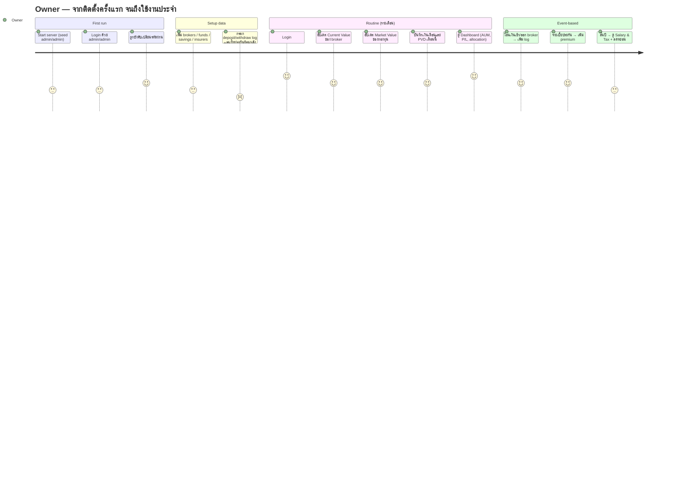
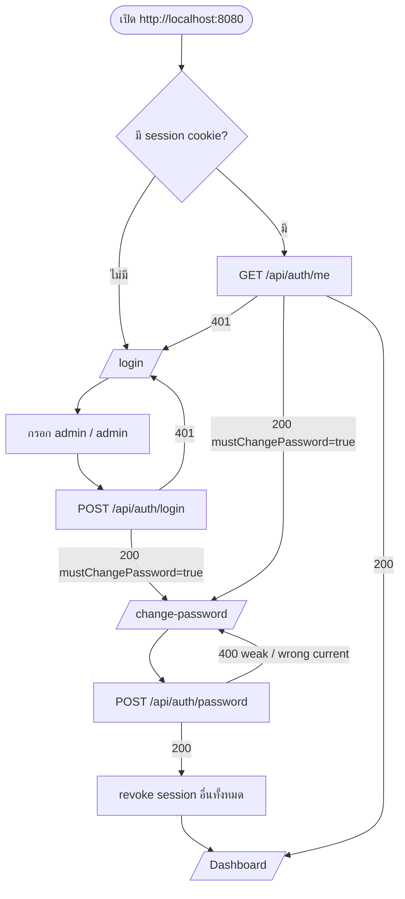
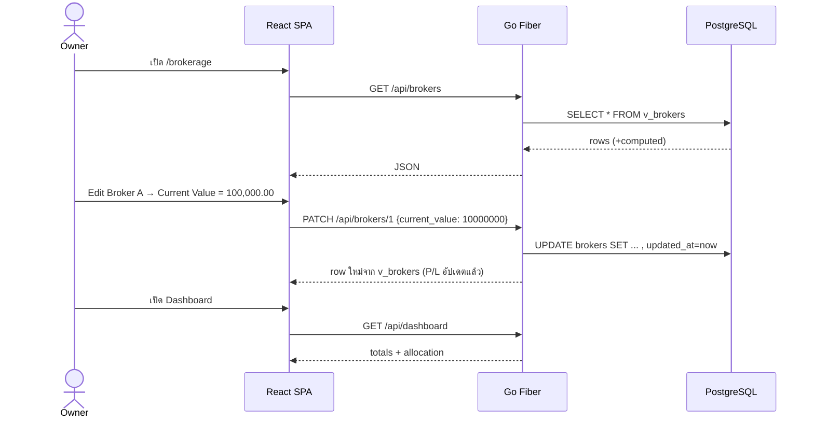

# 03 · User Journey

ผู้ใช้มีคนเดียวคือเจ้าของพอร์ต (role: owner/admin) งานหลักคือ **อัปเดตตัวเลขเป็นระยะ แล้วเปิดดูภาพรวม**
แทนการเปิด Excel

## Journey overview

คะแนน 1–5 = ความลื่นไหลที่คาดไว้ ส่วนที่ได้ 2 คือการกรอกข้อมูลย้อนหลัง ซึ่งเป็นเหตุผลที่ควรมีตัว import จาก Excel (ดู Open questions ใน 01)

## Flow 1 — First login (seeded admin/admin)

## Flow 2 — Monthly update

## Flow 3 — Session expiry

1. Cookie หมดอายุ (7 วัน) หรือ logout จากที่อื่น
2. API ใดก็ตามตอบ `401` แล้ว `api.ts` ยิง event `auth:expired`
3. `AuthProvider` set user = null ทำให้ `RequireAuth` redirect ไป `/login` พร้อม `state.from`
4. Login สำเร็จแล้วพากลับไปหน้าเดิม

## Edge cases ที่รองรับแล้ว

| กรณี | พฤติกรรม |
|---|---|
| เพิ่ม broker ชื่อซ้ำ | `409 a record with this value already exists` |
| Type ไม่ใช่ deposit/withdraw | `400 type must be one of [deposit withdraw]` |
| ลบ broker ที่มี log อยู่ | log ถูกลบไปด้วย (cascade) และ UI ถามยืนยันก่อน |
| Brute-force login | 10 ครั้ง/นาที/IP แล้วตอบ `429` |
| ยังไม่เปลี่ยนรหัสผ่าน แต่ยิง API ตรง | `403 PASSWORD_CHANGE_REQUIRED` |
